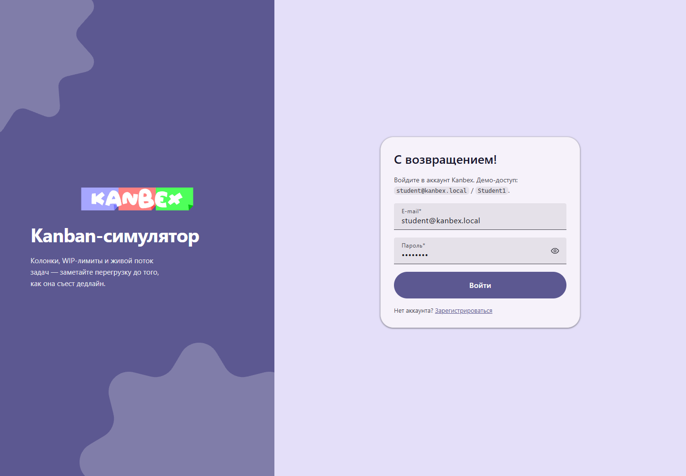
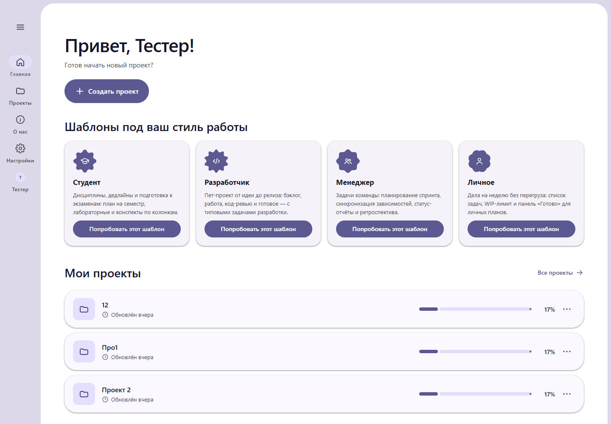
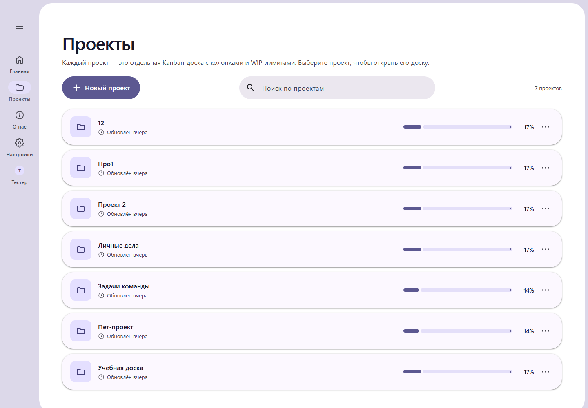
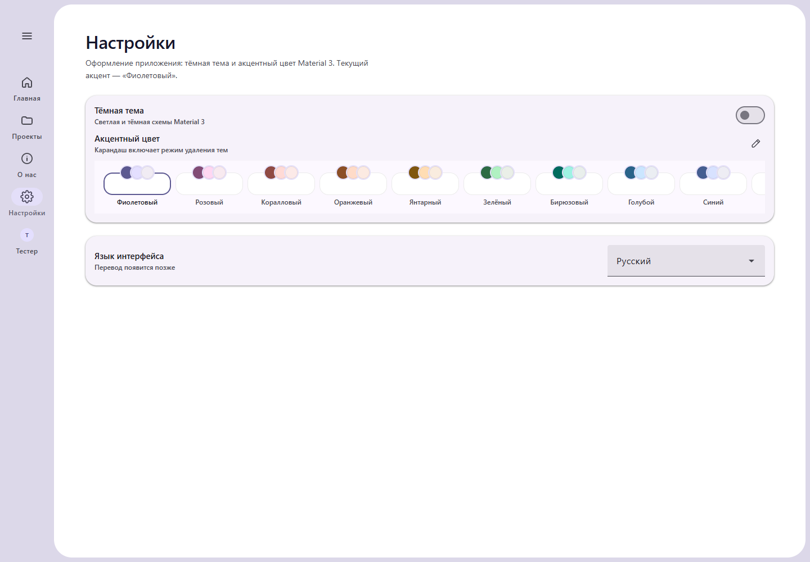
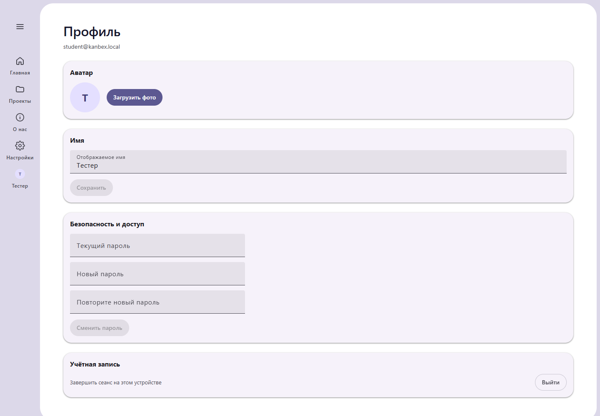
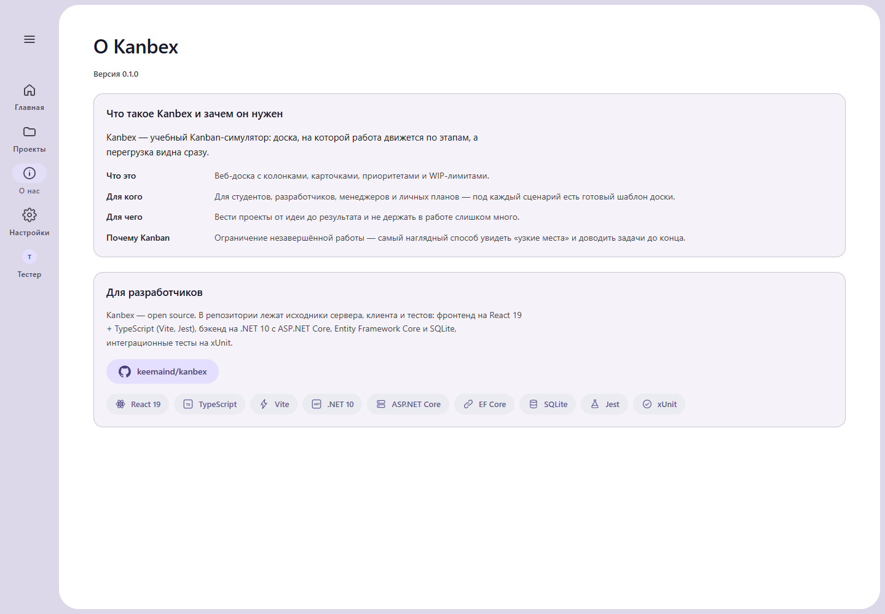

# Kanbex


**Версия 0.1.0** · учебный симулятор Kanban-потока

Kanbex — веб-симулятор Kanban-доски: колонки, карточки задач, приоритеты и WIP-лимиты. Он показывает, как визуализировать поток работ и ограничивать незавершённую работу, чтобы задачи доходили до «Готово», а не копились в работе.

В версии 0.1.0 работают регистрация и вход через ASP.NET Core Identity, серверное хранение досок в SQLite, совместная работа Creator/Member, поля карточек с исполнителем, дедлайном и оценкой, история изменений, комментарии, теги, публичные read-only ссылки `/share/{id}`, аватар на сервере, готовые шаблоны, drag-and-drop, автосохранение, персонализация оформления и общая библиотека компонентов `@kanbex/ui`.

## Скриншоты

| Вход | Главная |
|---|---|
|  |  |

| Проекты | Kanban-доска |
|---|---|
|  |  |

| Настройки | Профиль |
|---|---|
|  |  |



## Возможности

### Доски и поток работ

- список личных проектов с поиском, созданием и удалением, бейджами роли (владелец/участник);
- совместная работа: владелец добавляет участников по e-mail (`/api/boards/{id}/members`), участник работает с карточками, но не меняет название и настройки доски;
- главный экран с шаблонами сценариев и прогрессом последних проектов;
- четыре готовых шаблона доски: `student`, `developer`, `manager`, `personal` — создаются через `POST /api/boards/template/{key}` с колонками и демонстрационными карточками;
- рабочая область доски: шапка проекта с прогрессом, статусом сохранения и меню действий, тулбар и колонки со счётчиками;
- карточки задач с приоритетами, исполнителем, дедлайном (просроченный подсвечивается), оценкой и тегами, drag-and-drop и доступной альтернативой кнопками «Назад» / «Далее»;
- история карточки: создание, изменения полей, перемещения и смена исполнителя — `/api/boards/{id}/tasks/{taskId}/history`;
- комментарии к карточкам с правами «автор удаляет свой, владелец — любой»;
- каталог тегов доски (управляет владелец) и прикрепление тегов к карточкам;
- WIP-лимиты с обратной связью при отклонённом перемещении;
- автосохранение изменений и ручное сохранение;
- создание и редактирование карточек, настройка колонок, очистка задач и сброс доски к учебному набору;
- публичная read-only ссылка `/share/{id}`: анонимный доступ через `/api/public/boards/{id}`, приватная доска по ссылке отвечает «не найдена»;
- серверное хранение в SQLite: CRUD через `/api/boards/*`, проверка роли, версии и WIP.

### Оформление и интерфейс

- светлая и тёмная темы Material 3;
- акцентный seed-цвет, 10 готовых палитр и собственные темы из 30 цветов — с созданием, редактированием и удалением;
- настройки темы сохраняются в `localStorage` (`kanbex.theme`), режим выставляется как `data-theme-mode` на `<html>`;
- навигационная рельса `NavigationRail` вместо drawer: сворачивается и разворачивается, ведёт на главную, проекты, «О нас» и настройки, снизу — карточка пользователя;
- страницы настроек и профиля: аватар на сервере (кроп 160×160 JPEG, `POST/DELETE /api/auth/avatar`), отображаемое имя, смена пароля, выход из аккаунта;
- страница «О нас» с описанием проекта, ссылкой на GitHub и стеком технологий;
- сплит-лейаут входа с брендовой панелью и переключателем показа пароля.

### Аутентификация и качество

- ASP.NET Core Identity: cookie-сессия `Kanbex.Auth`, antiforgery для изменяющих запросов, защита `/api/auth/*`;
- эндпоинты профиля `POST /api/auth/display-name`, `POST /api/auth/change-password` и `POST/DELETE /api/auth/avatar`;
- общая библиотека `@kanbex/ui` с алиасами Material-компонентов, `KanbexLogo`, `KanbexMark` и бренд-токенами;
- ESLint, Jest, unit-тесты и coverage для frontend-проектов, xUnit-тесты API, миграций и Razor-хостов.

## Стек

| Слой | Технологии |
|---|---|
| Сервер | ASP.NET Core MVC / Web API, .NET 10, Entity Framework Core 10, SQLite, ASP.NET Core Identity |
| Клиент | React 19, TypeScript 5.9, Vite 8, React Router 7, `m3-expressive-react`, `@dnd-kit` |
| Библиотека UI | `@kanbex/ui` — React + TypeScript, общие компоненты без доменной логики |
| Качество | ESLint 9, typescript-eslint, Jest 30, Testing Library, xUnit |

Более подробное описание архитектуры, маршрутов и состава компонентов — в [architecture.md](architecture.md). Функциональные требования MVP — в [mvp.md](mvp.md).

## Брендинг

Основной логотип хранится в `docs/kanbex-logo.svg`, компактный знак — в `docs/kanbexLogo2.svg` и как React-компонент `KanbexMark` в `@kanbex/ui`. Favicon — `src/Kanbex.Web/wwwroot/favicon.svg`.

| Токен | HEX | Использование |
|---|---|---|
| `--kb-color-lilac` | `#9995FF` | Акцент этапа «К выполнению» |
| `--kb-color-lilac-soft` | `#ECEAFF` | Подложки и метки «К выполнению» |
| `--kb-color-purple` | `#6252E8` | Основной seed-цвет темы, primary-кнопки |
| `--kb-color-coral` | `#FF7777` | Акцент этапа «В работе», опасные состояния |
| `--kb-color-coral-soft` | `#FFE5E5` | Подложки и метки «В работе» |
| `--kb-color-green` | `#42E65A` | Акцент этапа «Готово», успех |
| `--kb-color-green-soft` | `#DFF8E3` | Подложки и метки «Готово» |
| `--kb-color-workspace` | `#E4DFF9` | Фон рабочей области приложения |
| `--kb-color-ink` | `#17172B` | Основной текст |
| `--kb-color-ink-secondary` | `#777793` | Вторичный текст |

Палитра доступна в CSS как `--kb-color-*` (`src/Kanbex.UI/src/styles/components.css`). Тема по умолчанию — светлая с seed-цветом `#6252E8`; остальные Material-токены генерируются из него через `generateColorScheme`.

## Структура репозитория

```text
.
├── Directory.Build.props          # единая версия 0.1.0 для .NET-проектов
├── architecture.md
├── mvp.md
├── README.md
├── docs/
│   ├── kanbex-logo.svg            # основной логотип
│   ├── kanbexLogo2.svg            # исходник компактного знака KanbexMark
│   └── screenshots/               # скриншоты для README
├── Kanbex.sln
├── src/
│   ├── Kanbex.Web/                # ASP.NET Core MVC/API и React-хост
│   │   └── ReactApp/              # React-приложение и его тесты
│   ├── Kanbex.Infrastructure/     # EF Core, SQLite, Identity persistence
│   ├── Kanbex.UI/                 # библиотека @kanbex/ui и её unit-тесты
│   └── Kanbex.Tests/              # xUnit-тесты API, миграций и Razor-хостов
├── package.json                   # npm workspaces и общие команды
└── package-lock.json
```

## Требования

- .NET SDK 10.0;
- Node.js 24+ и npm 11+;
- современный браузер.

## Установка

В корне репозитория:

```bash
npm install
dotnet restore
```

`npm install` устанавливает зависимости обоих npm workspace-пакетов: `@kanbex/web-client` и `@kanbex/ui`.

## Запуск

### Вариант 1. Полное приложение ASP.NET Core + Vite

Откройте два терминала в корне репозитория.

Терминал 1 — Vite dev server с HMR:

```bash
npm run dev
```

Терминал 2 — ASP.NET Core:

```bash
dotnet run --project src/Kanbex.Web --launch-profile http
```

Откройте <http://localhost:5130/home>. Razor-хост отдаёт React-приложение, а ViteDotNet подключает dev-модули и HMR.

### Вариант 2. Только React-клиент

```bash
npm run dev --workspace @kanbex/web-client
```

Откройте <http://localhost:5173/home>. Если ASP.NET Core из варианта 1 запущен, Vite проксирует `/api/*` на `http://localhost:5130`; без запущенного API вход и работа с досками недоступны.

## Проверки

Общие команды в корне:

```bash
npm run lint
npm run lint:fix
npm test
npm run test:coverage
npm run build
```

Команды по отдельным проектам:

```bash
npm run lint --workspace @kanbex/web-client
npm run lint --workspace @kanbex/ui
npm test --workspace @kanbex/web-client
npm test --workspace @kanbex/ui
npm run test:coverage --workspace @kanbex/ui
```

Требования к lint: 2 пробела, без `;`, без лишних пустых строк, без `any`, без предупреждений. Для компонентов `@kanbex/ui` настроен минимальный порог покрытия 70% по statements, branches, functions и lines.

Проверка .NET-сборки и тестов:

```bash
dotnet build Kanbex.sln
dotnet test Kanbex.sln
```

## Демонстрационные данные

Аутентификация работает через ASP.NET Core Identity: вход, регистрация и выход вызывают `/api/auth/*`, а браузер получает HttpOnly cookie `Kanbex.Auth`. Демонстрационный пользователь (`student@kanbex.local` / `Student1`) создаётся в Development при применении миграций.

Проекты хранятся в SQLite в `src/Kanbex.Web/kanbex.db`. Относительный `Data Source` из конфигурации якорится на content root приложения, поэтому файл базы не зависит от каталога запуска. В Development миграции и сиды применяются автоматически.

## Версия

Текущий релиз отмечен тегом `v0.1.0`.

## Статус реализации

Готово: структура решения, маршрутизация, страницы, компоненты, библиотека `@kanbex/ui`, тесты, lint, миграции EF Core, SQLite-база, аутентификация `/api/auth/*` с cookie-сессией и antiforgery, CRUD досок `/api/boards/*`, шаблоны досок, роли Creator/Member с участниками, поля карточек (исполнитель, дедлайн, оценка) с историей изменений, комментарии, теги, публичные read-only ссылки `/share/{id}`, аватар на сервере, сохранение полной доски с проверками роли, версии и WIP, перенос карточек, сброс доски, персонализация оформления, профиль и настройки.

Следующий этап: расширение тестового покрытия, CI и UX-доработки — см. [mvp.md](mvp.md) и [architecture.md](architecture.md).
