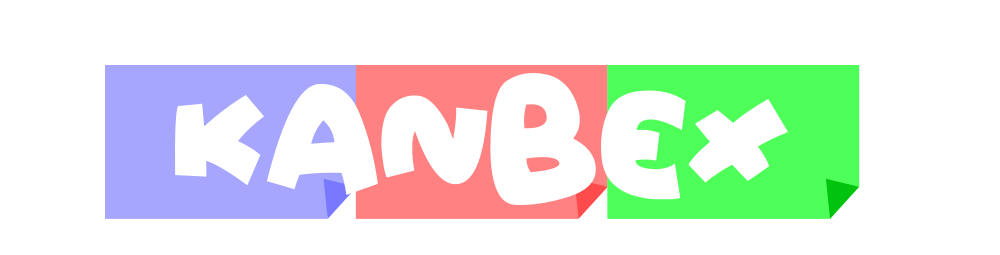
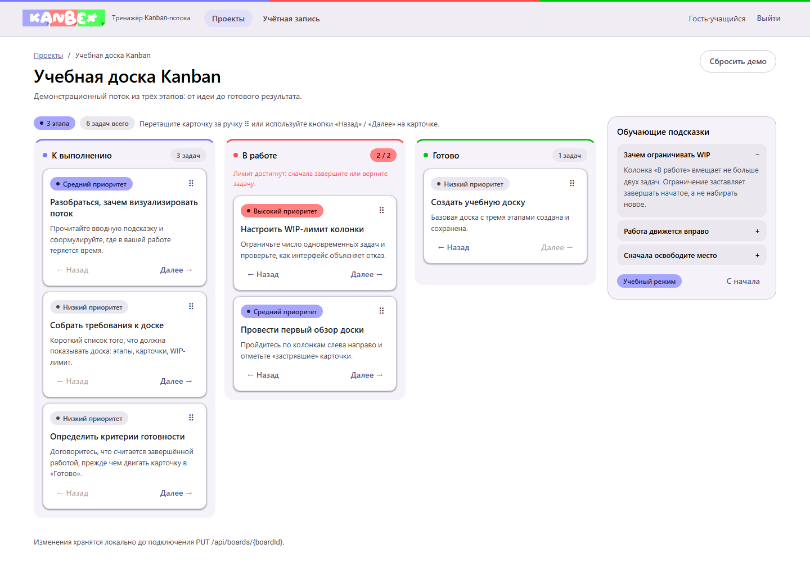

# Kanbex



Учебный симулятор Kanban-потока: Kanban-доска с тремя этапами, WIP-лимитом, карточками задач и обучающими подсказками. Проект показывает, как устроены визуализация потока работ и ограничение незавершённой работы.

Текущая версия — **рабочий MVP**. Регистрация, вход и выход обслуживаются ASP.NET Core Identity через `/api/auth/*` с HttpOnly cookie и antiforgery-токеном. Доски хранятся на сервере в SQLite: их можно создавать, открывать, сохранять, сбрасывать к учебному набору и удалять. Новая доска сразу содержит три колонки и демонстрационные карточки.




## Возможности каркаса

- список личных проектов с поиском, созданием и удалением;
- серверное хранение досок в SQLite: CRUD через `/api/boards/*`, проверка владельца, версии и WIP-лимита;
- новая доска с колонками и демонстрационными карточками;
- сброс доски к начальному учебному набору с подтверждением;
- Kanban-доска с колонками «К выполнению», «В работе» и «Готово»;
- карточки задач, приоритеты, WIP-лимит и обратная связь при отклонённом перемещении;
- создание задач с названием, описанием и приоритетом прямо в колонке;
- drag-and-drop карточек и доступная альтернатива кнопками «Назад» / «Далее»;
- обучающие подсказки о потоке и WIP;
- страницы входа, регистрации, профиля и 404;
- серверная аутентификация ASP.NET Core Identity: cookie-сессия, antiforgery и защита `/api/auth/*`;
- общая библиотека компонентов `@kanbex/ui`, реально используемая основным приложением;
- фирменный логотип и палитра бренда в шапке, колонках и метках статусов;
- ESLint, Jest, unit-тесты и coverage для frontend-проектов.

## Стек

| Слой | Технологии |
|---|---|
| Сервер | ASP.NET Core MVC / Web API, .NET 10, Entity Framework Core 10, SQLite, ASP.NET Core Identity |
| Клиент | React 19, TypeScript 5.9, Vite 8, React Router 7, `m3-expressive-react`, `@dnd-kit` |
| Библиотека UI | `@kanbex/ui` — React + TypeScript, общие компоненты без доменной логики |
| Качество | ESLint 9, typescript-eslint, Jest 30, Testing Library, `@testing-library/jest-dom` |

Более подробное описание архитектуры, маршрутов и состава компонентов — в [architecture.md](architecture.md). Функциональные требования MVP — в [mvp.md](mvp.md).

## Брендинг

Логотип хранится в `docs/kanbex-logo.svg` и как React-компонент `KanbexLogo` в `@kanbex/ui`, поэтому шапка приложения и страницы входа используют один и тот же знак. Favicon — `src/Kanbex.Web/wwwroot/favicon.svg`.

| Цвет | HEX | Использование |
|---|---|---|
| Белый | `#FFFFFF` | Фон и буквы логотипа, поверхности |
| Зелёный тёмный | `#00C30D` | Акцент колонки «Готово», метки успеха |
| Зелёный светлый | `#4EFF5A` | Фон меток успеха, карточка логотипа |
| Фиолетовый | `#7979FF` | Основной seed-цвет темы, акцент «К выполнению» |
| Фиолетовый светлый | `#A6A6FF` | Фон информационных меток, карточка логотипа |
| Красный тёмный | `#FE4B4B` | Акцент «В работе», опасные состояния |
| Красный светлый | `#FF8181` | Предупреждения и высокий приоритет |

Палитра доступна в CSS как `--kb-color-*` (`src/Kanbex.UI/src/styles/components.css`); `ThemeProvider` получает seed-цвет `#7979FF`, поэтому остальные Material-токены согласованы с логотипом.

## Структура репозитория

```text
.
├── architecture.md
├── mvp.md
├── README.md
├── docs/                          # логотип и скриншоты для README
│   ├── kanbex-logo.svg
│   └── screenshots/
├── Kanbex.sln
├── src/
│   ├── Kanbex.Web/                # ASP.NET Core MVC/API и React-хост
│   │   └── ReactApp/              # React-приложение и его тесты
│   ├── Kanbex.Infrastructure/     # EF Core, SQLite, Identity persistence
│   └── Kanbex.UI/                 # библиотека @kanbex/ui и её unit-тесты
├── package.json                   # npm workspaces и общие команды
└── package-lock.json
```

## Требования

- .NET SDK 10.0;
- Node.js 24+ и npm 11+;
- современный браузер.

## Установка

В корне репозитория:

```bash
npm install
dotnet restore
```

`npm install` устанавливает зависимости обоих npm workspace-пакетов: `@kanbex/web-client` и `@kanbex/ui`.

## Запуск

### Вариант 1. Полное приложение ASP.NET Core + Vite

Откройте два терминала в корне репозитория.

Терминал 1 — Vite dev server с HMR:

```bash
npm run dev
```

Терминал 2 — ASP.NET Core:

```bash
dotnet run --project src/Kanbex.Web --launch-profile http
```

Откройте <http://localhost:5130/boards>. Razor-хост отдаёт React-приложение, а ViteDotNet подключает dev-модули и HMR.

### Вариант 2. Только React-клиент

```bash
npm run dev --workspace @kanbex/web-client
```

Откройте <http://localhost:5173/boards>. Если ASP.NET Core из варианта 1 запущен, Vite проксирует `/api/*` на `http://localhost:5130`; без запущенного API вход и работа с досками недоступны.

## Проверки

Общие команды в корне:

```bash
npm run lint
npm run lint:fix
npm test
npm run test:coverage
npm run build
```

Команды по отдельным проектам:

```bash
npm run lint --workspace @kanbex/web-client
npm run lint --workspace @kanbex/ui
npm test --workspace @kanbex/web-client
npm test --workspace @kanbex/ui
npm run test:coverage --workspace @kanbex/ui
```

Требования к lint: 2 пробела, без `;`, без лишних пустых строк, без `any`, без предупреждений. Для компонентов `@kanbex/ui` настроен минимальный порог покрытия 70% по statements, branches, functions и lines.

Проверка .NET-сборки и тестов:

```bash
dotnet build Kanbex.sln
dotnet test Kanbex.sln
```

## Демонстрационные данные

Аутентификация работает через ASP.NET Core Identity: вход, регистрация и выход вызывают `/api/auth/*`, а браузер получает HttpOnly cookie `Kanbex.Auth`. Демонстрационный пользователь (`student@kanbex.local` / `Student1`) создаётся в Development при применении миграций. Проекты хранятся на сервере в SQLite и связаны с владельцем из сессии: новая доска создаётся вместе с демонстрационными карточками, а кнопка «Сбросить доску» возвращает её к начальному набору.

## Статус реализации

Готово: структура решения, маршрутизация, страницы, компоненты, библиотека `@kanbex/ui`, тесты, lint, миграции EF Core, SQLite-база, аутентификация `/api/auth/*` с cookie-сессией и antiforgery, CRUD досок `/api/boards/*`, сохранение полной доски с проверками владельца, версии и WIP, перенос карточек, сброс доски и демонстрационное содержимое новой доски.

Следующий этап: расширение тестового покрытия, CI и UX-доработки — см. [development-plan.md](development-plan.md).
